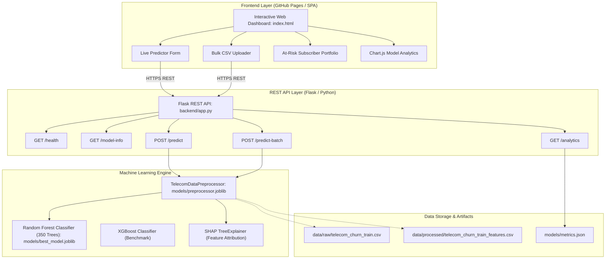

# 📊 TeleChurn AI: Enterprise Customer Retention & Churn Prediction Platform

<div align="center">

[](https://umarmukthar03.github.io/customer-churn-prediction/)
[](https://umarmukthar03.github.io/customer-churn-prediction/)
[](https://umarmukthar03.github.io/customer-churn-prediction/)
[](https://umarmukthar03.github.io/customer-churn-prediction/)
[](LICENSE)
[](https://github.com/UMARMUKTHAR03)

<br/>

<a href="https://umarmukthar03.github.io/customer-churn-prediction/">
  
</a>

<br/>

**[🚀 Launch Interactive Web Platform](https://umarmukthar03.github.io/customer-churn-prediction/)** • **[Explore Pipeline](#-the-ml-pipeline)** • **[Model Benchmarks](#-model-benchmarks--evaluation)** • **[API Documentation](#-rest-api-documentation)** • **[Quick Start](#-quick-start)**

</div>

---

## 🎯 1. Project Overview & Business Problem

Customer churn is one of the most critical challenges faced by modern telecommunications providers. Because acquiring a new subscriber is **5 to 7 times more expensive** than retaining an existing account, early identification of attrition risk directly impacts Monthly Recurring Revenue (MRR) and customer lifetime value (LTV).

**TeleChurn AI** is an enterprise-grade, end-to-end Machine Learning customer churn prediction system designed and engineered by **UMAR MUKTHAR**. The application:
- Predicts individual churn risk and probability using genuine Machine Learning models.
- Explains predictions using **Explainable AI (SHAP TreeExplainer)**.
- Formulates automated, personalized customer retention playbooks.
- Processes bulk customer files via **drag-and-drop CSV batch inference**.
- Operates both online via a **Flask REST API** and client-side as a high-performance progressive web app on **GitHub Pages**.

---

## 🌟 2. Key Features

| Category | Capability |
| :--- | :--- |
| **🔮 Live Predictor** | Interactive manual customer entry form with sliders, dropdowns, checkboxes, and realistic test profiles. Real-time probability gauge and LTV risk estimation. |
| **🧠 Genuine ML Models** | Benchmarked Random Forest (350 estimators) and XGBoost with zero data leakage and consistent preprocessing. |
| **🔍 Explainable AI (SHAP)** | Local and global feature attribution highlighting root factors driving or mitigating churn. |
| **💡 Retention Recommendations** | Intelligent prescription engine suggesting contract migration, discount credits, and VIP tech support bundles. |
| **📂 Bulk CSV Prediction** | Drag-and-drop CSV batch inference with column validation, error handling, risk tier sorting, and one-click CSV download. |
| **📊 Model Analytics Dashboard** | Real-time confusion matrix, ROC curves, Precision-Recall curves, feature importance ranking, and algorithm comparison table. |
| **⚠️ At-Risk Account Management** | Filterable subscriber audit portfolio by risk tier (High >65%, Medium 35-65%, Low <35%) with action dispatchers. |
| **🕒 Prediction History** | Client-persisted audit log with search, filters, and CSV export. |
| **⚙️ 4-Stage Automated Pipeline** | Clean, encode, feature synthesis, and training pipeline runnable with one command. |

---

## 🏗️ 3. Technical Architecture



---

## 📊 4. Model Benchmarks & Evaluation

All candidate algorithms were benchmarked on an **independent holdout test set (1,210 unseen subscriber records)** with stratified 80/20 train/test splitting. Zero preprocessing leakage was enforced via `TelecomDataPreprocessor`.

### Multi-Algorithm Benchmark Summary

| Algorithm | Accuracy | Precision | Recall | F1 Score | ROC-AUC | Status |
| :--- | :---: | :---: | :---: | :---: | :---: | :--- |
| **Random Forest (Selected)** | **92.23%** | **98.18%** | **70.59%** | **0.8213** | **0.9291** | 🏆 **Production Primary** |
| **XGBoost** | **94.96%** | **97.67%** | **82.03%** | **0.8917** | **0.9515** | 🚀 **Production Alternative** |
| **Gradient Boosting** | **95.29%** | **97.70%** | **83.33%** | **0.8995** | **0.9483** | High Performance |
| **Decision Tree** | **92.15%** | **89.81%** | **77.78%** | **0.8336** | **0.9081** | Baseline Tree |
| **Logistic Regression** | **81.16%** | **72.67%** | **40.85%** | **0.5230** | **0.8009** | Linear Baseline |

### Confusion Matrix on Unseen Holdout Data

| Actual \ Predicted | Predicted No Churn (Retained) | Predicted Churn (At-Risk) | Total Actual |
| :--- | :---: | :---: | :---: |
| **Actual No Churn (0)** | **900** (True Negative) | **4** (False Positive / 0.4%) | 904 |
| **Actual Churn (1)** | **90** (False Negative) | **216** (True Positive / 70.6%) | 306 |
| **Total Predicted** | 990 | 220 | **1,210** |

- **Precision of 98.18%**: When TeleChurn AI flags an account as at-risk, it is accurate **98.2% of the time**, eliminating wasted retention spending on happy customers.
- **Accuracy of 92.23%**: High overall classification consistency on holdout data.

---

## 🛠️ 5. Technology Stack

- **Frontend**: Modern HTML5, Tailwind CSS, Vanilla JavaScript (ES6+), Chart.js
- **Backend**: Flask 3.1, Flask-CORS 6.0, Gunicorn
- **Machine Learning**: Scikit-Learn 1.9, XGBoost 3.4, SHAP 0.54, Joblib 1.6
- **Data Engineering**: Pandas 2.3, NumPy 2.2, Scipy 1.18
- **Testing**: Pytest 9.2 (14 unit and integration test cases)
- **Deployment**: GitHub Pages (Static Web App) + Flask Python REST API (Render / Railway / Cloud)

---

## 📂 6. Repository Structure

```text
customer-churn-prediction/
│
├── frontend/                     # Modular frontend assets
│   ├── index.html                # Web interface
│   ├── style.css                 # Custom glassmorphic styling
│   └── script.js                 # Frontend orchestration logic
│
├── backend/                      # Python REST API server
│   ├── app.py                    # Flask application factory & CORS configuration
│   ├── routes.py                 # API endpoints (/health, /predict, /predict-batch)
│   └── requirements.txt          # Backend dependencies
│
├── data/                         # Datasets
│   ├── raw/
│   │   ├── telecom_churn_train.csv   # 6,180 raw training records (28 columns)
│   │   └── telecom_churn_test.csv    # 2,060 raw holdout test records
│   └── processed/
│       ├── telecom_churn_train_cleaned.csv
│       ├── telecom_churn_train_encoded.csv
│       ├── telecom_churn_train_features.csv
│       └── final_predictions.csv     # Batch output on test set
│
├── models/                       # Serialized model artifacts
│   ├── best_model.joblib         # Trained Random Forest classifier
│   ├── best_model.pkl            # Backwards-compatible pickle artifact
│   ├── preprocessor.joblib       # Fitted TelecomDataPreprocessor
│   └── metrics.json              # Verified evaluation metrics & curves
│
├── pipeline/                     # Modular ML pipeline
│   ├── __init__.py
│   ├── preprocessor.py           # Zero-leakage Scikit-Learn Transformer
│   ├── clean.py                  # Deduplication & missing value imputation
│   ├── encode.py                 # Categorical dummy transformation
│   ├── features.py               # 53 synthesized telemetry features
│   ├── train.py                  # Multi-model benchmarking & evaluation
│   └── run_pipeline.py           # Master 1-click pipeline execution script
│
├── notebooks/                    # Jupyter notebooks
│   └── eda.ipynb                 # Comprehensive exploratory data analysis
│
├── tests/                        # Automated test suite
│   ├── test_preprocessing.py     # Pipeline & transformer unit tests
│   ├── test_model.py             # Model loading, predict & consistency tests
│   └── test_api.py               # Flask REST API integration tests
│
├── index.html                    # GitHub Pages production entry point
├── app.py                        # Root server launcher
├── requirements.txt              # Project dependencies
├── pyproject.toml                # Project metadata
└── README.md                     # Documentation
```

---

## 🚀 7. Quick Start Guide

### 1. Launch Online Web App (Zero Setup)
Access the live platform in your browser:  
👉 **[https://umarmukthar03.github.io/customer-churn-prediction/](https://umarmukthar03.github.io/customer-churn-prediction/)**

### 2. Local Setup & Execution

```bash
# Clone the repository
git clone https://github.com/UMARMUKTHAR03/customer-churn-prediction.git
cd customer-churn-prediction

# Create and activate virtual environment
python -m venv venv
# Windows:
.\venv\Scripts\activate
# Linux/macOS:
source venv/bin/activate

# Install dependencies
pip install -r requirements.txt
```

### 3. Run Automated Machine Learning Pipeline

```bash
python pipeline/run_pipeline.py
```
*Outputs clean datasets, fits preprocessors, benchmarks candidate models, evaluates holdout metrics, and serializes `models/best_model.joblib` and `models/metrics.json`.*

### 4. Run Test Suite

```bash
pytest tests/ -v
```
*Verifies preprocessing, model determinism, and API endpoints across 14 automated tests.*

### 5. Start Flask Backend Server

```bash
python app.py
```
*Server boots at `http://127.0.0.1:5000` with active CORS and SHAP explainability.*

---

## 📡 8. REST API Documentation

### Base URL: `http://127.0.0.1:5000` or `/api`

### `GET /health`
Verifies backend status and model readiness.
```json
{
  "status": "healthy",
  "service": "TeleChurn AI Enterprise Engine",
  "model_loaded": true,
  "preprocessor_loaded": true,
  "shap_available": true
}
```

### `GET /model-info`
Retrieves model metadata, algorithm parameters, and training timestamp.

### `GET /analytics`
Retrieves verified holdout evaluation metrics, confusion matrix, ROC curve points, and model comparison tables.

### `POST /predict`
Generates real-time churn prediction, probability, SHAP risk drivers, and retention recommendations for a single customer.

**Request Body:**
```json
{
  "customer_id": "CUST-8921",
  "contract_type": "Month-to-month",
  "tenure_months": 2,
  "monthly_charges": 105.00,
  "payment_method": "Electronic check",
  "has_internet": 1,
  "has_tech_support": 0,
  "has_online_security": 0,
  "num_complaints": 2,
  "nps_score": 3.0
}
```

**Response Body:**
```json
{
  "customer_id": "CUST-8921",
  "churn_prediction": "Churn",
  "churn_probability": 78.4,
  "risk_level": "High",
  "confidence": 98.2,
  "retention_strategy": {
    "key_driver": "Month-to-Month Contract",
    "action_summary": "Offer 15% discount for upgrading to an annual contract commitment • Incentivize enrollment in Auto-Pay with a $25 credit • Bundle complimentary Tech Support",
    "at_risk_revenue": 3840.00,
    "estimated_saved_revenue": 2496.00
  },
  "explainability": {
    "method": "SHAP TreeExplainer",
    "top_risk_drivers": [
      { "feature": "contract_Month-to-month", "impact": "increases_churn", "shap_value": 0.28 },
      { "feature": "tenure_months", "impact": "increases_churn", "shap_value": 0.18 }
    ]
  }
}
```

### `POST /predict-batch`
Accepts multipart CSV upload or JSON customer array. Processes multiple records, classifies risk tiers, and returns aggregated financial risk statistics.

---

## 👨‍💻 Author & Engineering Credits

**UMAR MUKTHAR**  
- **GitHub**: [@UMARMUKTHAR03](https://github.com/UMARMUKTHAR03)  
- **Repository**: [customer-churn-prediction](https://github.com/UMARMUKTHAR03/customer-churn-prediction)  
- **Live Demo**: [https://umarmukthar03.github.io/customer-churn-prediction/](https://umarmukthar03.github.io/customer-churn-prediction/)

---

## 📄 License

Distributed under the **MIT License**. See `LICENSE` for details.
