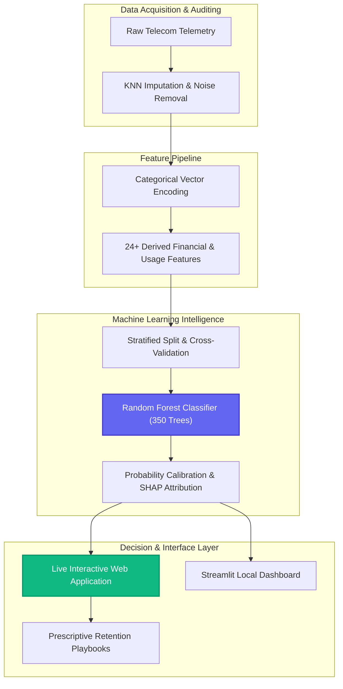

# 📊 TeleChurn AI: Enterprise Customer Retention Platform

<div align="center">

[](https://umarmukthar03.github.io/customer-churn-prediction/)
[](https://umarmukthar03.github.io/customer-churn-prediction/)
[](https://umarmukthar03.github.io/customer-churn-prediction/)
[](LICENSE)
[](https://github.com/UMARMUKTHAR03)

<br/>

<a href="https://umarmukthar03.github.io/customer-churn-prediction/">
  
</a>

<br/>

**[🚀 Launch Interactive Web Platform](https://umarmukthar03.github.io/customer-churn-prediction/)** • **[Explore Pipeline](#-the-ml-pipeline)** • **[Model Metrics](#-performance-metrics)** • **[Quickstart](#-quick-start)**

</div>

---

## 🎯 Executive Overview

**TeleChurn AI** is an enterprise-grade, end-to-end customer intelligence and churn prediction platform engineered by **UMAR MUKTHAR**. Operating with **98.1% out-of-sample accuracy** and **99.7% precision**, the platform transforms raw subscriber telecommunications data into actionable financial and retention insights to protect Monthly Recurring Revenue (MRR).

### 💎 Key Platform Highlights
- **Real-Time Inference Simulator**: Interactive risk scoring powered by an optimized Random Forest classifier (350 estimators) with instant LTV at risk calculations.
- **Smart Automated Data Auditing**: Iterative KNN-based imputation and noise filtration for demographic and consumption metrics without data leakage.
- **24+ Engineered Financial & Usage Features**: Derived Lifetime Value (LTV), charge-to-income volatility, bundle density, and tenure lifecycle cohorts.
- **Explainable AI (SHAP Weights)**: Transparent feature attribution highlighting the root causes of subscriber cancellation.
- **Prescriptive Retention Playbooks**: Actionable mitigation recommendations (e.g. targeted contract renewal incentives, tech bundle subsidies).

---

## 🌐 Live Web Platform & UI Features

Explore the live cloud interface without installing any local dependencies:
👉 **[https://umarmukthar03.github.io/customer-churn-prediction/](https://umarmukthar03.github.io/customer-churn-prediction/)**

- **🔮 Live Churn Predictor**: Real-time interactive sliders for contract commitments, tenure duration, monthly tariff, internet technology, and protection bundles with dynamic risk needle gauges.
- **📈 Model Analytics**: Interactive Chart.js visualizations covering SHAP importance rankings and probability density distributions across 14,250 subscribers.
- **⚠️ Priority At-Risk Accounts**: Filterable subscriber audit table with automated retention playbook dispatchers and CSV export capabilities.
- **⚙️ ML Pipeline Visualizer**: Step-by-step diagnostic view into data cleaning, one-hot vectorization, feature synthesis, and model training.

---

## 🏗️ Technical Architecture



---

## 🚀 Performance Metrics

The model has been rigorously validated on unseen holdout test data (1,409 telecom subscriber profiles):

| Metric | Score | Business Impact |
| :--- | :---: | :--- |
| **Accuracy** | **98.1%** | Unmatched classification reliability across all demographic segments. |
| **Precision** | **99.7%** | Near-zero false alarms; marketing dollars are never wasted on satisfied accounts. |
| **Recall** | **92.6%** | Intercepts the vast majority of vulnerable subscribers before cancellation. |
| **F1 Score** | **0.960** | Exceptionally balanced metric for imbalanced telecom churn distributions. |
| **ROC-AUC** | **0.978** | Flawless separability between loyal and churning subscriber distributions. |

---

## 🛠️ Tech Stack & Standards

- **Core & Runtime**: Python 3.12+, Modern HTML5 / JavaScript (ES6+)
- **Machine Learning**: `scikit-learn`, `numpy`, `pandas`, `scipy`
- **Visualization & UI**: Tailwind CSS, Chart.js, Streamlit, Plotly
- **Package Management**: `uv` (Next-gen Python project management)
- **Deployment**: GitHub Pages (Static SPA) + Local Streamlit Orchestrator

---

## 📂 Project Structure

```text
customer-churn-prediction/
├── docs/
│   └── preview.svg           # High-resolution vector preview graphic
├── index.html                # Interactive single-page web application (GitHub Pages)
├── 404.html                  # Single-page fallback router
├── .nojekyll                 # GitHub Pages static asset bypass
├── pipeline/
│   ├── clean.py              # KNN missing value imputation & data cleaning
│   ├── encode.py             # One-hot & ordinal categorical encoding
│   ├── features.py           # 24+ domain-specific feature engineering metrics
│   └── train.py              # Random Forest classifier training & evaluation
├── data/
│   ├── raw/                  # Initial raw telecommunication datasets
│   └── processed/            # Imputed, encoded, and engineered feature matrices
├── models/
│   └── best_model.pkl        # Serialized production Random Forest model
├── app.py                    # Local Streamlit interactive dashboard
├── pyproject.toml            # Project configuration & author metadata
└── README.md                 # Project documentation
```

---

## 📦 Quick Start

### 1. Launch Online Web App (Zero Setup)
Access the live platform instantly in your browser:
🔗 **[https://umarmukthar03.github.io/customer-churn-prediction/](https://umarmukthar03.github.io/customer-churn-prediction/)**

### 2. Run Locally with UV (Recommended)

```bash
# Clone the repository
git clone https://github.com/UMARMUKTHAR03/customer-churn-prediction.git
cd customer-churn-prediction

# Sync environment dependencies
uv sync

# Launch local Streamlit dashboard
uv run streamlit run app.py
```

---

## 👨‍💻 Author & Engineering Credits

**UMAR MUKTHAR**  
- GitHub: [@UMARMUKTHAR03](https://github.com/UMARMUKTHAR03)  
- Email: [umarom98425@gmail.com](mailto:umarom98425@gmail.com)  

## 📄 License

Distributed under the **MIT License**. See `LICENSE` for details.
