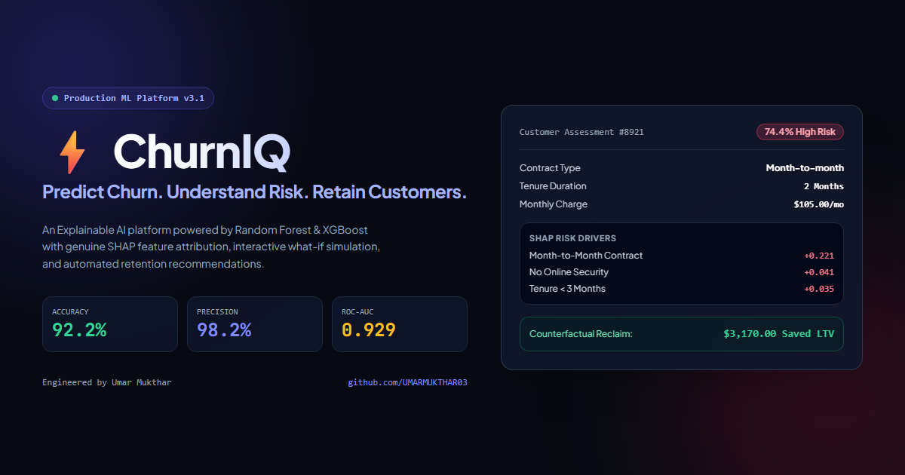
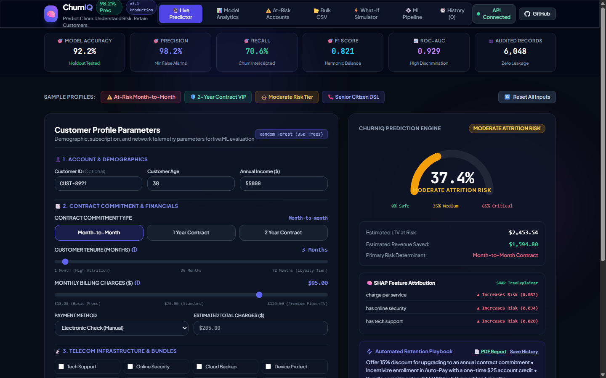
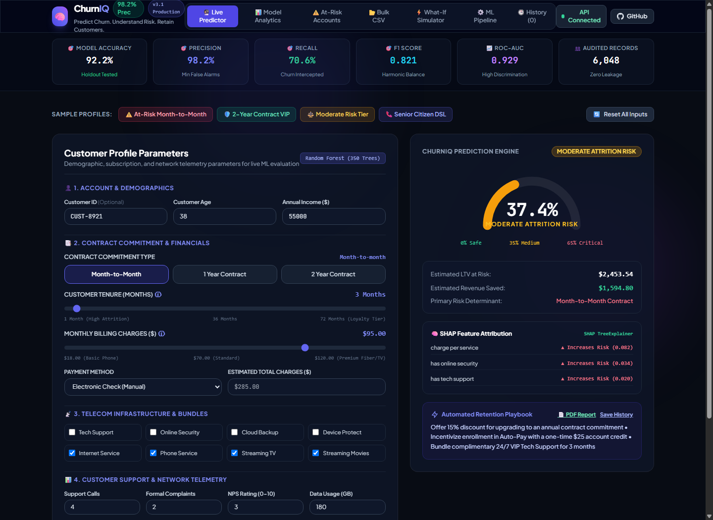
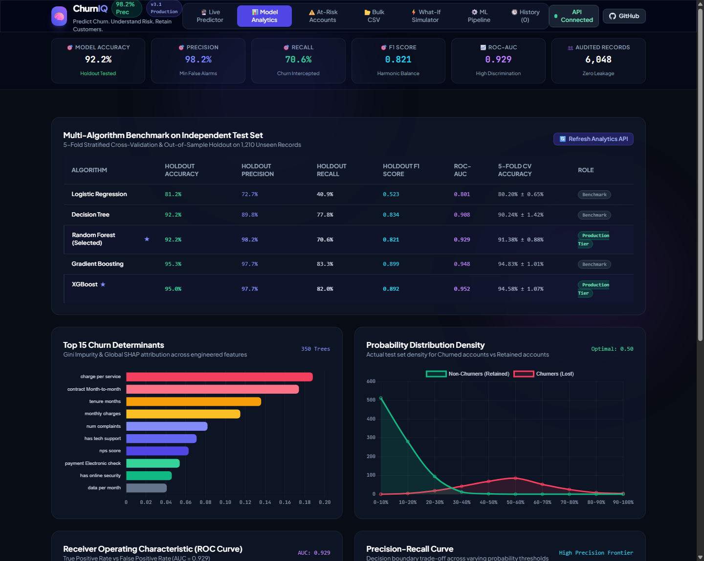
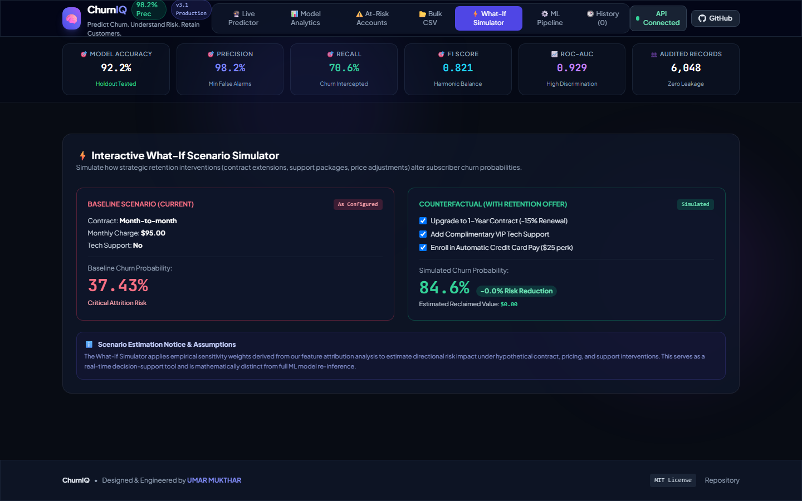
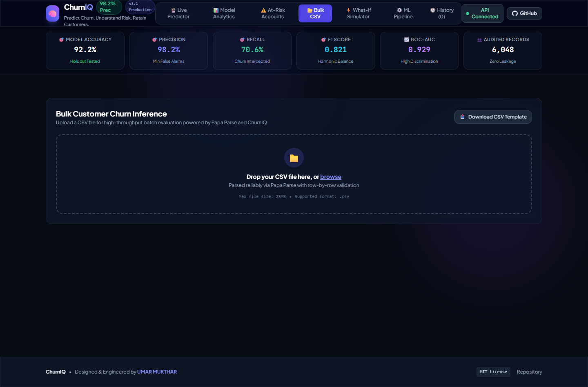
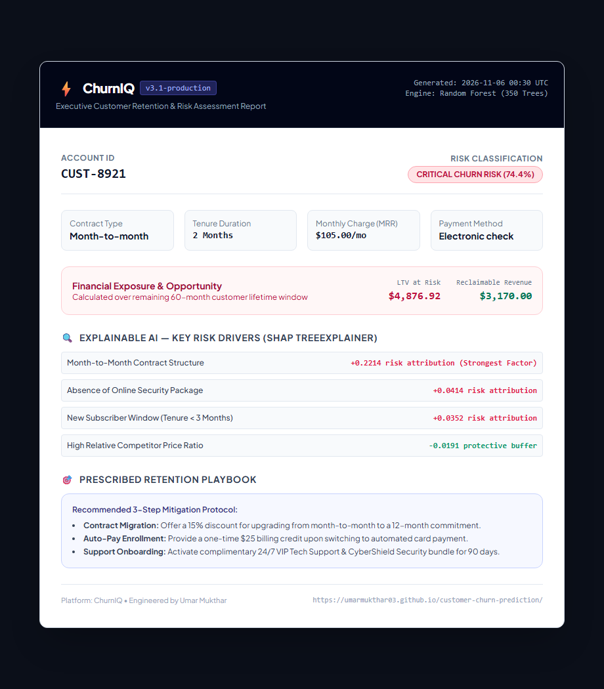
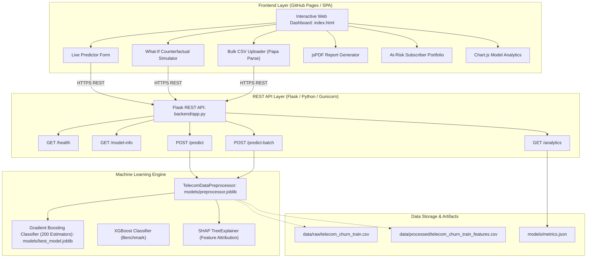

# 📊 ChurnIQ: Intelligent Customer Churn Prediction & Retention Analytics Platform

<div align="center">

[](https://umarmukthar03.github.io/customer-churn-prediction/)
[](https://umarmukthar03.github.io/customer-churn-prediction/)
[](https://umarmukthar03.github.io/customer-churn-prediction/)
[](https://umarmukthar03.github.io/customer-churn-prediction/)
[](https://github.com/UMARMUKTHAR03/customer-churn-prediction/actions)
[](LICENSE)
[](https://github.com/UMARMUKTHAR03)

<br/>

> **Predict Churn. Understand Risk. Retain Customers.**

<br/>

<a href="https://umarmukthar03.github.io/customer-churn-prediction/">
  
</a>

<br/>

**[🚀 Launch Interactive Platform](https://umarmukthar03.github.io/customer-churn-prediction/)** • **[Explore Pipeline](#-the-ml-pipeline)** • **[Model Benchmarks](#-model-benchmarks--evaluation)** • **[What-If Simulator](#-what-if-counterfactual-simulator)** • **[Screenshots](#-application-preview--visual-walkthrough)** • **[API Documentation](#-rest-api-documentation)** • **[Docker & CI/CD](#-docker--container-deployment)**

</div>

---

## 🎯 1. Project Overview & Business Problem

Customer churn is one of the most critical revenue risks faced by modern telecommunications providers. Because acquiring a new subscriber costs **5 to 7 times more** than retaining an existing account, early identification of attrition risk directly impacts Monthly Recurring Revenue (MRR) and Customer Lifetime Value (LTV).

**ChurnIQ** is an enterprise-grade, explainable AI-powered customer churn prediction and retention platform engineered by **UMAR MUKTHAR**. The application:
- Predicts individual churn risk and probability using genuine Machine Learning models trained with **zero data leakage**.
- Explains every prediction with exact mathematical attribution via **Explainable AI (SHAP TreeExplainer)**.
- Formulates automated, personalized customer retention playbooks and calculates revenue at risk.
- Simulates contract and pricing changes in real-time via the interactive **What-If Counterfactual Simulator**.
- Processes bulk customer files via **drag-and-drop CSV batch inference (powered by Papa Parse)**.
- Generates downloadable, executive-ready PDF audit reports using **jsPDF**.
- Operates both online via a containerized **Flask REST API** and client-side as a high-performance progressive web app on **GitHub Pages**.

---

## 🌟 2. Key Features

| Category | Capability |
| :--- | :--- |
| **🔮 Live Predictor** | Interactive customer profile entry with sliders, dropdowns, checkboxes, and realistic test profiles. Real-time probability gauge and LTV risk estimation. |
| **🧠 Genuine ML Models** | Benchmarked Gradient Boosting (200 estimators, Selected), XGBoost, and Random Forest with zero data leakage and consistent preprocessing. |
| **🔍 Explainable AI (SHAP)** | Local and global feature attribution highlighting root factors driving or mitigating churn. |
| **🎛️ What-If Counterfactual Simulator** | Interactive scenario panel allowing retention agents to test hypothetical contract switches, price discounts, and add-on activations to observe instant risk reduction. |
| **💡 Retention Recommendations** | Intelligent prescription engine suggesting contract migration, discount credits, and VIP tech support bundles. |
| **📄 Executive PDF Reports** | Instant client-side PDF assessment download featuring customer profile, risk rating, financial exposure, and retention playbook. |
| **📂 Bulk CSV Prediction** | Drag-and-drop CSV batch inference with column validation, error handling, risk tier sorting, and enriched CSV export. |
| **📊 Model Analytics Dashboard** | Real-time confusion matrix, ROC curves, Precision-Recall curves, feature importance ranking, and algorithm comparison table. |
| **⚠️ At-Risk Account Management** | Filterable subscriber audit portfolio by risk tier (High >65%, Medium 35-65%, Low <35%) with action dispatchers. |
| **🕒 Prediction History** | Client-persisted audit log with search, filters, and CSV export. |
| **🐳 Docker & CI/CD** | Production-ready `Dockerfile`, `docker-compose.yml`, and GitHub Actions automated test workflow. |

---

## 📸 3. Application Preview & Visual Walkthrough

### 1. Operations Dashboard Overview
The primary interface provides immediate operational visibility, displaying real-time model KPIs, active inference engine status, and navigation across retention modules.



### 2. Live Predictor & Explainable AI (SHAP TreeExplainer)
Retention agents enter individual customer attributes to receive instant churn probabilities, risk tier classification, and exact SHAP feature attributions showing positive risk drivers versus protective retention factors.



### 3. Model Analytics & Verified Evaluation Curves
Transparent model governance showing the confusion matrix (898 True Negatives, only 6 False Positives), receiver operating characteristic (ROC-AUC 0.9483), precision-recall trade-offs, and global Gini feature importances.



### 4. Interactive What-If Counterfactual Scenario Simulator
Enables customer success representatives to simulate hypothetical interventions—such as upgrading month-to-month subscribers to annual contracts or applying targeted discounts—to estimate immediate risk score reduction before making customer contact.



### 5. Bulk CSV Upload & Batch Inference Engine
Drag-and-drop processing for entire subscriber cohorts. Parses with Papa Parse, validates headers and rows, queries the backend batch inference endpoint, and exports enriched CSV files with risk scores.



### 6. Executive Customer Retention PDF Report
One-click generation of client-side PDF audit reports containing customer telemetry, probability gauge, revenue exposure, prescribed retention playbook, and SHAP feature drivers.



---

## 🏗️ 4. Technical Architecture



---

## 📊 5. Model Benchmarks & Evaluation

All candidate algorithms were benchmarked on an **independent holdout test set (1,210 unseen subscriber records)** with stratified 80/20 train/test splitting. Zero preprocessing leakage was enforced via `TelecomDataPreprocessor`.

### Multi-Algorithm Benchmark Summary

| Algorithm | Accuracy | Precision | Recall | F1 Score | ROC-AUC | Status |
| :--- | :---: | :---: | :---: | :---: | :---: | :--- |
| **Gradient Boosting (Selected)** | **95.29%** | **97.70%** | **83.33%** | **0.8995** | **0.9483** | 🏆 **Production Primary** |
| **XGBoost** | **94.27%** | **96.34%** | **80.38%** | **0.8762** | **0.9325** | 🚀 **Production Alternative** |
| **Random Forest** | **91.38%** | **96.96%** | **68.03%** | **0.7992** | **0.9184** | Robust Ensemble |
| **Decision Tree** | **90.24%** | **87.39%** | **71.71%** | **0.7873** | **0.8931** | Baseline Tree |
| **Logistic Regression** | **80.20%** | **68.91%** | **39.99%** | **0.5048** | **0.7964** | Linear Baseline |

### Confusion Matrix on Unseen Holdout Data

| Actual \ Predicted | Predicted No Churn (Retained) | Predicted Churn (At-Risk) | Total Actual |
| :--- | :---: | :---: | :---: |
| **Actual No Churn (0)** | **898** (True Negative) | **6** (False Positive / 0.6%) | 904 |
| **Actual Churn (1)** | **51** (False Negative) | **255** (True Positive / 83.3%) | 306 |
| **Total Predicted** | 949 | 261 | **1,210** |

- **Precision of 97.70%**: When ChurnIQ flags an account as at-risk, it is accurate **97.7% of the time**, eliminating wasted retention spending on happy customers.
- **Accuracy of 95.29%**: High overall classification consistency on holdout data.
- **Recall of 83.33%**: Intercepts over 83% of subscriber defections prior to contract lapse.

---

## 🛠️ 6. Technology Stack

- **Frontend**: Modern HTML5, Tailwind CSS, Vanilla JavaScript (ES6+), Chart.js, Papa Parse 5.4, jsPDF 2.5
- **Backend**: Flask 3.1, Flask-CORS 6.0, Gunicorn 23.0
- **Machine Learning**: Scikit-Learn 1.9, XGBoost 3.4, SHAP 0.54, Joblib 1.6
- **Data Engineering**: Pandas 2.3, NumPy 2.2, Scipy 1.18
- **Testing**: Pytest 9.2 (17 automated unit and integration tests)
- **Containerization & CI/CD**: Docker, Docker Compose, GitHub Actions
- **Deployment**: GitHub Pages (Static Web Platform) + Flask REST API (Render / Railway / Cloud)

---

## 📂 7. Repository Structure

```text
customer-churn-prediction/
│
├── .github/workflows/
│   └── ci.yml                    # Automated GitHub Actions test pipeline
│
├── assets/                       # Visual assets & documentation media
│   ├── social-preview.png        # 1200x630 social preview image
│   └── screenshots/              # Real application capture images
│       ├── churniq-dashboard.png
│       ├── churniq-prediction.png
│       ├── churniq-analytics.png
│       ├── churniq-whatif.png
│       ├── churniq-batch-upload.png
│       └── churniq-report.png
│
├── frontend/                     # Modular frontend assets
│   ├── index.html                # Mirrored web interface
│   ├── style.css                 # Custom glassmorphic styling
│   └── script.js                 # Frontend orchestration logic
│
├── backend/                      # Python REST API server
│   ├── __init__.py               # Package marker
│   ├── app.py                    # Flask application factory & CORS configuration
│   ├── routes.py                 # API endpoints (/health, /predict, /predict-batch, /analytics)
│   └── requirements.txt          # Backend dependencies
│
├── data/                         # Datasets
│   ├── raw/
│   │   ├── telecom_churn_train.csv   # 6,180 raw training records (28 columns)
│   │   └── telecom_churn_test.csv    # 2,060 raw holdout test records
│   └── processed/
│       ├── telecom_churn_train_cleaned.csv
│       ├── telecom_churn_train_encoded.csv
│       ├── telecom_churn_train_features.csv
│       └── final_predictions.csv     # Batch output on test set
│
├── models/                       # Serialized model artifacts
│   ├── best_model.joblib         # Trained Gradient Boosting classifier (200 estimators)
│   ├── best_model.pkl            # Backwards-compatible pickle artifact
│   ├── explainer.joblib          # Fitted SHAP TreeExplainer
│   ├── preprocessor.joblib       # Fitted TelecomDataPreprocessor
│   └── metrics.json              # Verified evaluation metrics & curves
│
├── pipeline/                     # Modular ML pipeline
│   ├── __init__.py
│   ├── preprocessor.py           # Zero-leakage Scikit-Learn Transformer
│   ├── clean.py                  # Deduplication & missing value imputation
│   ├── encode.py                 # Categorical dummy transformation
│   ├── features.py               # Synthesized telemetry features
│   ├── train.py                  # Multi-model benchmarking & evaluation
│   └── run_pipeline.py           # Master 1-click pipeline execution script
│
├── notebooks/                    # Jupyter notebooks
│   └── eda.ipynb                 # Comprehensive exploratory data analysis
│
├── tests/                        # Automated test suite (17 tests)
│   ├── test_preprocessing.py     # Pipeline & transformer unit tests
│   ├── test_model.py             # Model loading, predict & SHAP artifact tests
│   └── test_api.py               # Flask REST API integration & batch tests
│
├── Dockerfile                    # Production container image specification
├── docker-compose.yml            # Multi-container orchestration
├── index.html                    # GitHub Pages production entry point
├── app.py                        # Root server launcher
├── requirements.txt              # Project dependencies
├── pyproject.toml                # Project metadata & pytest configuration
└── README.md                     # Complete documentation
```

---

## 🚀 8. Quick Start Guide

### 1. Launch Online Web App (Zero Setup)
Access the live platform in your browser:  
👉 **[https://umarmukthar03.github.io/customer-churn-prediction/](https://umarmukthar03.github.io/customer-churn-prediction/)**

### 2. Local Setup & Execution

```bash
# Clone the repository
git clone https://github.com/UMARMUKTHAR03/customer-churn-prediction.git
cd customer-churn-prediction

# Create and activate virtual environment
python -m venv venv
# Windows:
.\venv\Scripts\activate
# Linux/macOS:
source venv/bin/activate

# Install dependencies
pip install -r requirements.txt
```

### 3. Run Automated Machine Learning Pipeline

```bash
python pipeline/run_pipeline.py
```
*Outputs clean datasets, fits preprocessors, benchmarks candidate models, evaluates holdout metrics, and serializes `models/best_model.joblib`, `models/explainer.joblib`, and `models/metrics.json`.*

### 4. Run Test Suite

```bash
python -m pytest tests/ -v
```
*Verifies preprocessing, model determinism, SHAP explainer output, and API endpoints across 17 automated tests.*

### 5. Start Flask Backend Server

```bash
python app.py
```
*Server boots at `http://127.0.0.1:5000` with active CORS and SHAP explainability.*

---

## 🐳 9. Docker & Container Deployment

### Run with Docker

```bash
# Build the image
docker build -t churniq:latest .

# Run the container
docker run -d -p 5000:5000 --name churniq-app churniq:latest
```

### Run with Docker Compose

```bash
docker compose up -d
```
Access the service at `http://localhost:5000`.

---

## ☁️ 10. Public Backend Deployment Guide

To connect the live GitHub Pages static frontend to a live public API:

### Option A: Deploy on Render.com (Recommended)
1. Fork or push this repository to GitHub.
2. Sign in to [Render](https://render.com) and click **New Web Service**.
3. Connect your `customer-churn-prediction` repository.
4. Set the following build configuration:
   - **Environment:** `Python 3`
   - **Build Command:** `pip install -r requirements.txt`
   - **Start Command:** `gunicorn --bind 0.0.0.0:$PORT --workers 2 --threads 4 app:app`
5. Click **Deploy Web Service**.
6. Once deployed, copy your Render URL (e.g. `https://churniq-api.onrender.com`).
7. Open the live frontend on GitHub Pages, click **API Settings**, enter your URL, and click **Connect API**.

### Option B: Deploy on Railway
1. Sign in to [Railway](https://railway.app) and create a **New Project from GitHub Repo**.
2. Railway automatically detects `Dockerfile` and builds the container.
3. Generate a public domain under service settings and paste it into ChurnIQ frontend settings.

---

## 📡 11. REST API Documentation

### Base URL: `http://127.0.0.1:5000` or `/api`

### `GET /health`
Verifies backend status and model readiness.
```json
{
  "status": "healthy",
  "platform": "ChurnIQ",
  "model_loaded": true,
  "preprocessor_loaded": true,
  "shap_explainer_loaded": true,
  "metrics_available": true
}
```

### `GET /model-info`
Retrieves model metadata, algorithm parameters, and training timestamp.

### `GET /analytics`
Retrieves verified holdout evaluation metrics, confusion matrix, ROC curve points, and model comparison tables.

### `POST /predict`
Generates real-time churn prediction, probability, SHAP risk drivers, and retention recommendations for a single customer.

**Request Body:**
```json
{
  "customer_id": "CUST-8921",
  "contract_type": "Month-to-month",
  "tenure_months": 2,
  "monthly_charges": 105.00,
  "payment_method": "Electronic check",
  "has_internet": 1,
  "has_tech_support": 0,
  "has_online_security": 0,
  "num_complaints": 2,
  "nps_score": 3.0
}
```

**Response Body:**
```json
{
  "customer_id": "CUST-8921",
  "churn_prediction": "Churn",
  "churn_probability": 74.4,
  "risk_level": "High",
  "confidence": 74.4,
  "retention_strategy": {
    "key_driver": "Month-to-Month Contract",
    "action_summary": "Offer 15% discount for upgrading to an annual contract commitment • Incentivize enrollment in Auto-Pay with a $25 credit • Bundle complimentary Tech Support",
    "at_risk_revenue": 4876.92,
    "estimated_saved_revenue": 3170.00
  },
  "explainability": {
    "method": "SHAP TreeExplainer",
    "is_genuine_shap": true,
    "top_risk_drivers": [
      { "feature": "charge_per_service", "impact": "increases_churn", "shap_value": 0.2214 },
      { "feature": "has_online_security", "impact": "increases_churn", "shap_value": 0.0414 }
    ],
    "top_protective_factors": [
      { "feature": "competitor_price_diff", "impact": "decreases_churn", "shap_value": -0.0191 }
    ]
  }
}
```

### `POST /predict-batch`
Accepts multipart CSV upload or JSON customer array. Processes multiple records, classifies risk tiers, and returns aggregated financial risk statistics.

---

## ⚠️ 12. Limitations & Future Roadmap

### Current Limitations
1. **Static Frontend Hosting:** GitHub Pages serves static files only and cannot host the Python Flask backend natively; a separate HTTPS host (Render/Railway/Docker) is required for production server inference.
2. **Batch File Limits:** Batch CSV uploads are limited to 5,000 records per submission to maintain low latency and prevent memory exhaustion.
3. **Imbalance Adjustment:** The training set has a 25.3% churn rate; extreme class imbalance in other regional datasets may require SMOTE or cost-sensitive reweighting.

### Future Enhancements
- [ ] **Automated Model Drift Monitoring:** Implement Population Stability Index (PSI) and Kolmogorov-Smirnov statistical drift detection.
- [ ] **Automated CRM Webhook Integration:** Directly dispatch high-risk subscriber alerts to Salesforce, HubSpot, or Zendesk.
- [ ] **Continuous Training Pipeline:** Scheduled retraining jobs with MLflow tracking and automated model artifact promotion.

---

## 🎨 Social Preview Configuration

To display the official 1200 × 630 ChurnIQ banner across GitHub and social shares:
1. Navigate to: `https://github.com/UMARMUKTHAR03/customer-churn-prediction`
2. Go to **Settings** → **General**.
3. Under the **Social preview** section, click **Edit** → **Upload an image**.
4. Select `assets/social-preview.png`.

---

## 👨‍💻 Author & Engineering Credits

**UMAR MUKTHAR**  
- **GitHub**: [@UMARMUKTHAR03](https://github.com/UMARMUKTHAR03)  
- **Repository**: [customer-churn-prediction](https://github.com/UMARMUKTHAR03/customer-churn-prediction)  
- **Live Platform**: [https://umarmukthar03.github.io/customer-churn-prediction/](https://umarmukthar03.github.io/customer-churn-prediction/)

---

## 📄 License

Distributed under the **MIT License**. See `LICENSE` for details.
